<picture>
  <source media="(prefers-color-scheme: dark)" srcset="assets/hero-dark.gif">
  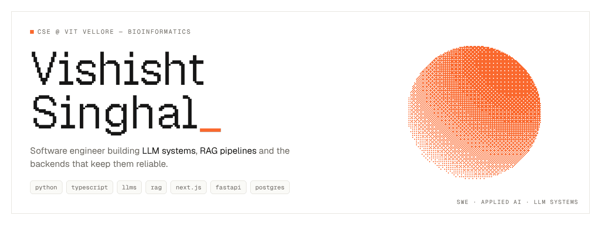
</picture>

  
  
  

<picture>
  <source media="(prefers-color-scheme: dark)" srcset="assets/h-about-dark.png">
  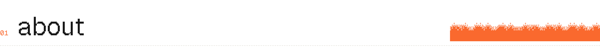
</picture>

<picture>
  <source media="(prefers-color-scheme: dark)" srcset="assets/terminal-dark.svg">
  
</picture>

I'm a final-year Computer Science Engineering student at VIT Vellore, specializing in Bioinformatics. Most of my work is in **software engineering and applied AI**: LLM applications, RAG systems, backend development and data-driven systems. I've also done research in machine learning, biomedical AI and decision systems.

<picture>
  <source media="(prefers-color-scheme: dark)" srcset="assets/h-experience-dark.png">
  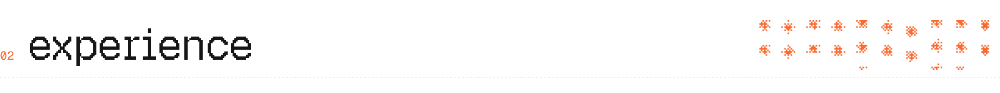
</picture>

<picture>
  <source media="(prefers-color-scheme: dark)" srcset="assets/timeline-dark.png">
  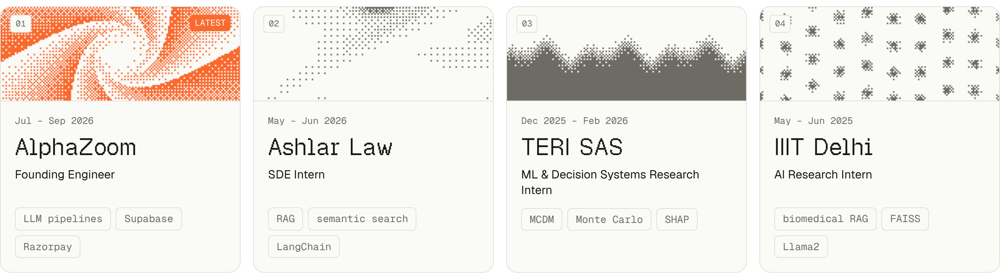
</picture>

<b>AlphaZoom</b> · Founding Engineer · <i>Jul – Sep 2026 · stealth-mode startup</i>

 

B2B SaaS platform for **Generative Engine Optimization**.

- Multi-provider LLM pipelines across OpenAI, Gemini and Perplexity
- Structured-output validation and fallback generation
- Prompt- and brand-data-versioned caching
- Usage tracking and subscription limits
- PostgreSQL / Supabase backend and Razorpay billing integration

`Next.js` `TypeScript` `Supabase` `PostgreSQL` `Razorpay` · [storyboard →](storyboards/alphazoom/)

<b>Ashlar Law</b> · Software Development Engineer Intern · <i>May – Jun 2026</i>

 

Semantic search and RAG for querying legal documents, previous matters, regulatory material and published legal research.

`Python` `LangChain` `LLMs` `RAG` `Semantic Search` · [storyboard →](storyboards/ashlar-law/)

<b>TERI SAS</b> · ML & Decision Systems Research Intern · <i>Dec 2025 – Feb 2026</i>

 

MCDM + machine-learning framework for climate-risk decision making: expert-weighted criteria, Monte Carlo simulation and explainable ML.

`Python` `XGBoost` `Random Forest` `SHAP` `MCDM` · [storyboard →](storyboards/teri/)

<b>IIIT Delhi</b> · AI Research Intern · <i>May – Jun 2025</i>

 

Local biomedical RAG pipeline over biomedical databases, combining contextual retrieval, semantic search, FAISS, Llama2 and BioChatter.

`Python` `LangChain` `FAISS` `Llama2` `BioChatter` · [storyboard →](storyboards/iiitd/)

<picture>
  <source media="(prefers-color-scheme: dark)" srcset="assets/h-projects-dark.png">
  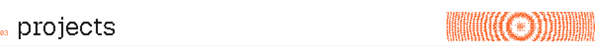
</picture>

  <a href="https://github.com/SVishisht/ShopSplain"><picture>
    <source media="(prefers-color-scheme: dark)" srcset="assets/project-shopsplain-dark.gif">
    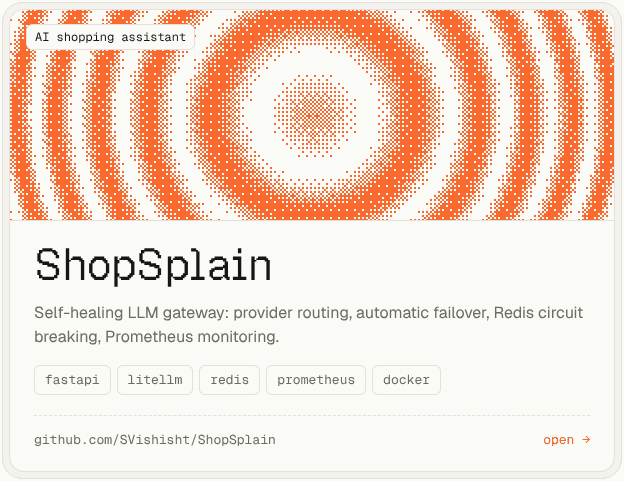
  </picture></a>
  <a href="https://regulara.io"><picture>
    <source media="(prefers-color-scheme: dark)" srcset="assets/project-regulara-dark.gif">
    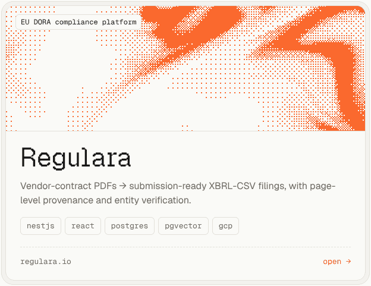
  </picture></a>

<b>How ShopSplain's gateway heals itself</b>

 

<picture>
  <source media="(prefers-color-scheme: dark)" srcset="assets/gateway-dark.svg">
  
</picture>

Requests route through a FastAPI gateway. When a provider starts failing, a Redis-backed circuit breaker opens and LiteLLM fails traffic over to a healthy provider. Health checks bring it back, and everything is exported to Prometheus.

<picture>
  <source media="(prefers-color-scheme: dark)" srcset="assets/h-storyboards-dark.png">
  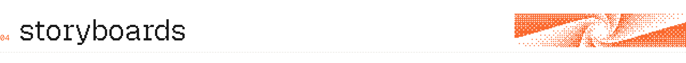
</picture>

Some of my internship and research work lives in private repositories. These storyboards walk through the problem, approach and architecture **without exposing private code or data**.

  <a href="storyboards/alphazoom/">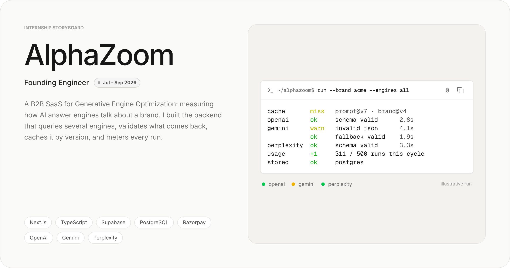</a>
  
  
  

<picture>
  <source media="(prefers-color-scheme: dark)" srcset="assets/h-stack-dark.png">
  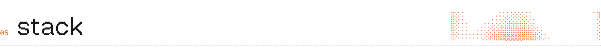
</picture>

<picture>
  <source media="(prefers-color-scheme: dark)" srcset="assets/stack-dark.png">
  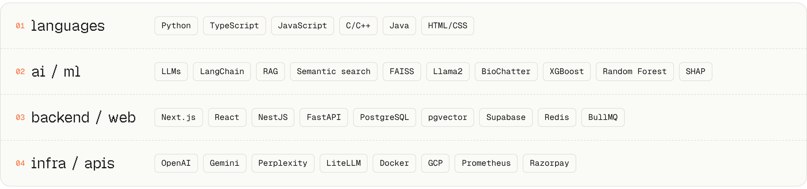
</picture>

**Also:** Machine Learning Specialization (Coursera, Andrew Ng) · Senior Core Member, Computer Society of India, VIT Vellore

 

<picture>
  <source media="(prefers-color-scheme: dark)" srcset="assets/footer-dark.gif">
  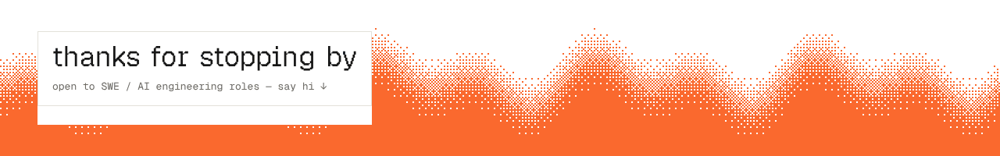
</picture>

  
  

dithering via <a href="https://github.com/paper-design/shaders">paper shaders</a> · layout ideas from <a href="https://www.cult-ui.com/">Cult UI</a> · type: Geist Pixel

