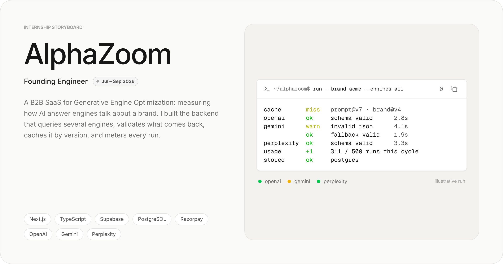
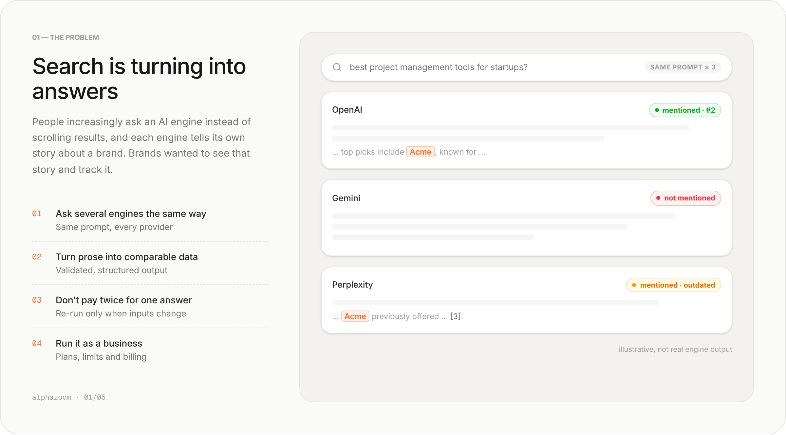
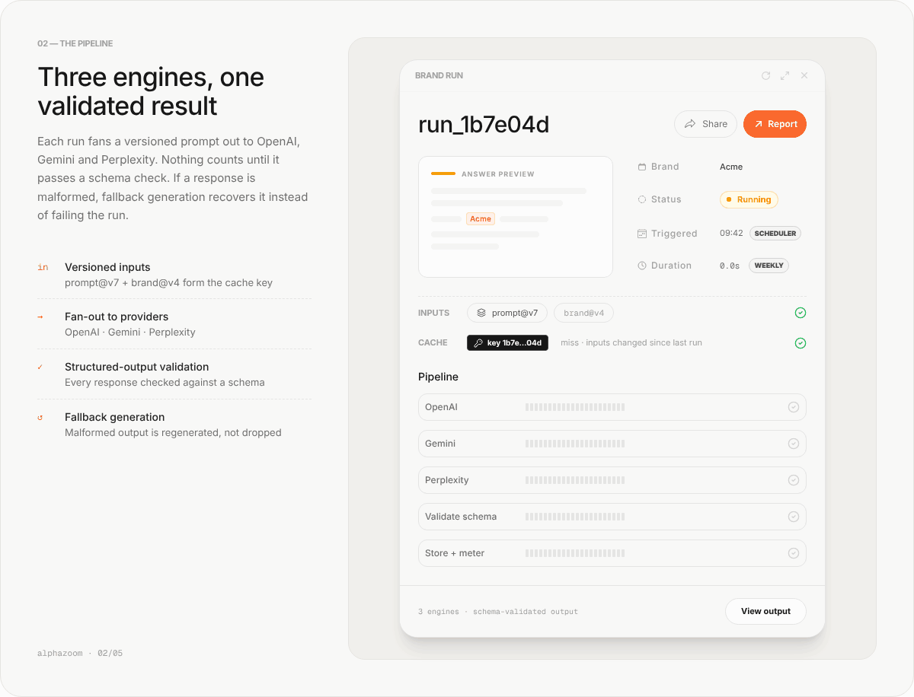
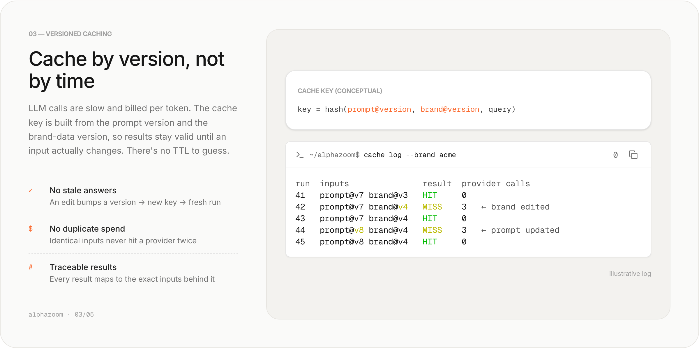
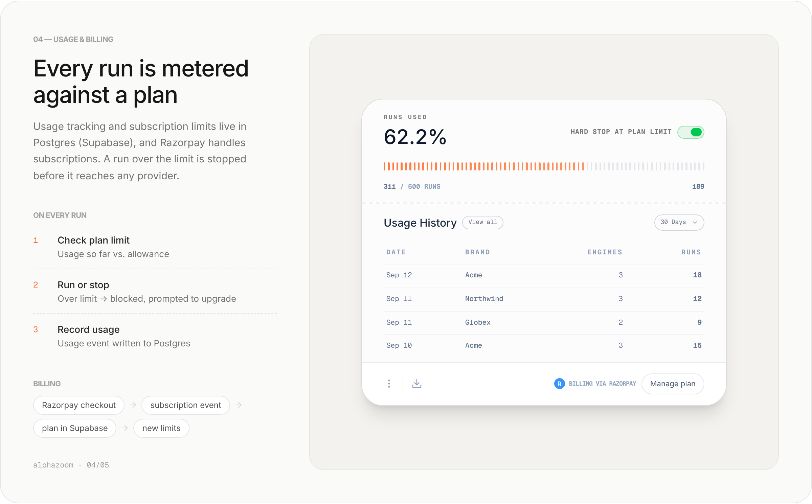
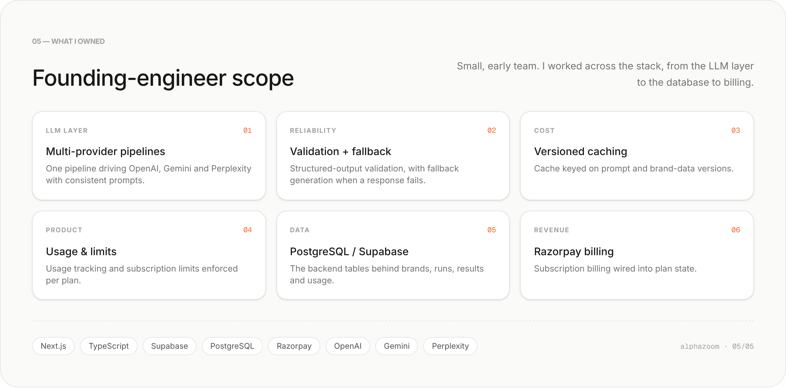

**Founding Engineer · AlphaZoom · Jul – Sep 2026** 
Stealth-mode B2B SaaS for Generative Engine Optimization

`Next.js` `TypeScript` `Supabase` `PostgreSQL` `Razorpay` `OpenAI` `Gemini` `Perplexity`

> **Why a storyboard?** AlphaZoom's code is private, so this walks through the problem, the architecture and my part in it.
> Diagrams are conceptual. No proprietary code, prompts or customer data is shown.

---

## 01 · The problem

People increasingly ask AI engines for recommendations instead of searching, and each engine (OpenAI, Gemini, Perplexity) can describe the same brand differently, or leave it out entirely. **Generative Engine Optimization** is about measuring and improving how a brand shows up in those answers.

To do that as a product, the platform had to:

1. Ask several engines **the same way**
2. Turn free-text answers into **structured, comparable data**
3. Avoid **paying twice** for the same answer
4. Run as a **business**, with plans, limits and billing

---

## 02 · The pipeline

A run takes a **versioned brand profile** and a **versioned prompt template**, checks the cache, then fans out to **OpenAI, Gemini and Perplexity**.

Every response has to pass **structured-output validation** before it counts. When one comes back malformed (in the animation, Gemini's output fails validation), **fallback generation** recovers it so the run still completes. Results are normalized and stored in **PostgreSQL / Supabase**.

**What I built:** the multi-provider pipeline, the validation layer and the fallback path.

---

## 03 · Versioned caching

LLM calls are slow and billed per token, so caching mattered for both latency and cost. Rather than expiring entries on a timer, the cache is keyed on the **prompt version and the brand-data version**:

- **Nothing changed** → cache hit, no provider call
- **Brand data or prompt changed** → the version bumps, the key changes, and the run goes fresh

This gives invalidation by construction: no stale answers after an edit, no duplicate spend on identical runs, and every result traces back to the exact inputs that produced it.

---

## 04 · Usage & billing

Every run is **metered against the customer's plan**. Usage tracking and subscription limits live in Postgres, and a run over the limit is stopped before any LLM call is made. **Razorpay** handles subscriptions, and plan changes flow back into the backend so the limits always match what the customer pays for.

---

## 05 · What I owned

As a founding engineer on an early team, I worked across the stack:

| Area | Work |
|---|---|
| LLM layer | Multi-provider pipelines across OpenAI, Gemini and Perplexity |
| Reliability | Structured-output validation and fallback generation |
| Cost | Prompt- and brand-data-versioned caching |
| Product | Usage tracking and subscription limits |
| Data | PostgreSQL / Supabase backend |
| Revenue | Razorpay billing integration |

---

UI components adapted from <a href="https://ui.watermelon.sh/">Watermelon UI</a> (MIT). Data in the frames is illustrative. 
← <a href="../../">back to profile</a>

